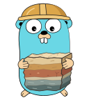

# <a href="https://github.com/zigai/strata"></a> strata

**Configuration for Go that remembers where every value came from.**

Put your settings in a struct with some defaults. strata fills it in from config files, environment variables, and CLI flags. If a value looks wrong, you can ask where it came from.

[](https://github.com/zigai/strata/actions/workflows/test.yml)
[](https://github.com/zigai/strata/releases/latest)
[](https://pkg.go.dev/github.com/zigai/strata)
[](go.mod)
[](LICENSE)

<br clear="right">

- **One struct is the whole config.** No string keys, no separate schema.
- **Layers stack up.** Files, environment variables, and flags each override the one below.
- **Every value has a source.** Ask strata which file set it.
- **Edits keep the user's formatting.** Change a key without losing their comments.

## Installation

```sh
go get github.com/zigai/strata
```

Requires Go 1.27 or newer.

## Examples

### Load a config

```go
package main

import (
	"fmt"
	"log"

	"github.com/zigai/strata"
)

type Config struct {
	Host string
	Port int
}

func (c *Config) SetDefaults() {
	c.Host = "127.0.0.1"
	c.Port = 8080
}

func main() {
	cfg, err := strata.Load[Config](
		strata.WithPath("config.toml"),
		strata.WithFormats("toml"),
	)
	if err != nil {
		log.Fatal(err)
	}

	fmt.Printf("listening on %s:%d\n", cfg.Host, cfg.Port)
}
```

Put `port = 9000` in `config.toml` and run it:

```text
listening on 127.0.0.1:9000
```

### Read environment variables and user config files

```go
cfg, err := strata.Load[Config](
	strata.WithAppName("myapp"),
	strata.WithFormats("toml"),
	strata.WithEnvPrefix("MYAPP_"),
)
```

Now `MYAPP_PORT` overrides `~/.config/myapp/config.toml`, which overrides `/etc/xdg/myapp/config.toml`.

### Add CLI flags

Bind flags with the Cobra bridge, `github.com/zigai/strata/bridge/cobra`:

```go
var cfg Config
root := &cobra.Command{Use: "myapp", Run: func(cmd *cobra.Command, args []string) {
	fmt.Println(cfg.Host, cfg.Port)
}}
b := stratacobra.Bind(root, &cfg, strata.WithFormats("toml"), strata.WithEnvPrefix("MYAPP_"))
b.FlagP(root.Flags(), "port", "p", "port to listen on")
```

A flag the user types overrides every other layer. [`examples/cli`](examples/cli) is a complete CLI.

### Find where a value came from

```go
cfg, meta, err := strata.LoadWithMetadata[Config](strata.WithAppName("myapp"), strata.WithFormats("toml"))

origin, _ := meta.Where("port")
fmt.Println(origin.Source, origin.Path)
// user /home/you/.config/myapp/config.toml
```

### Catch typos

Pass `strata.WithStrict()` to turn unknown keys into errors:

```text
config error: unknown key "prot" (did you mean "port"?)
  --> set by /home/you/project/config.toml
```

### Check values

strata calls `Validate` after it merges every layer:

```go
func (c *Config) Validate() error {
	if c.Port > 9000 {
		return errors.New("port is too high")
	}
	return nil
}
```

### Edit a config file

`Set` changes one key and keeps the file's comments:

```go
err := strata.Set[Config]("config.toml", "database.port", "5433")
```

### Keep secrets out of logs

A `strata.Secret` field prints as redacted:

```go
type Config struct {
	APIKey strata.Secret
}
```

## License

[MIT](LICENSE)
